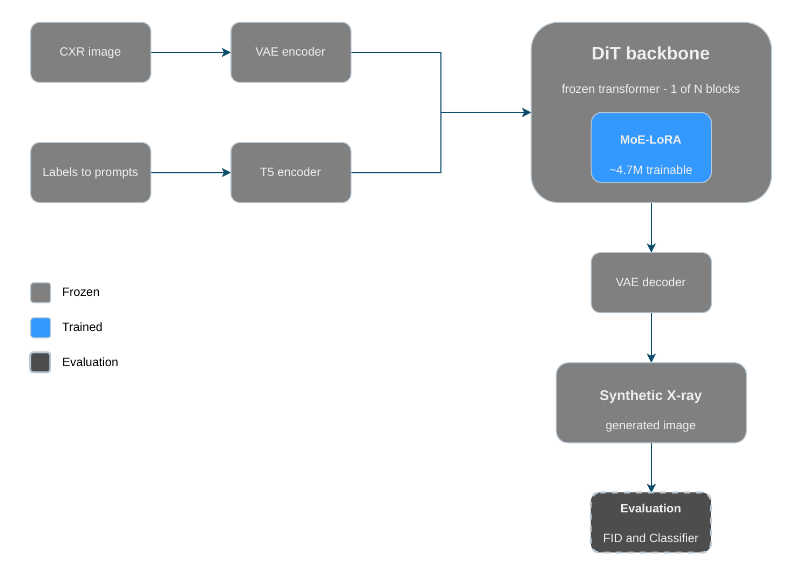
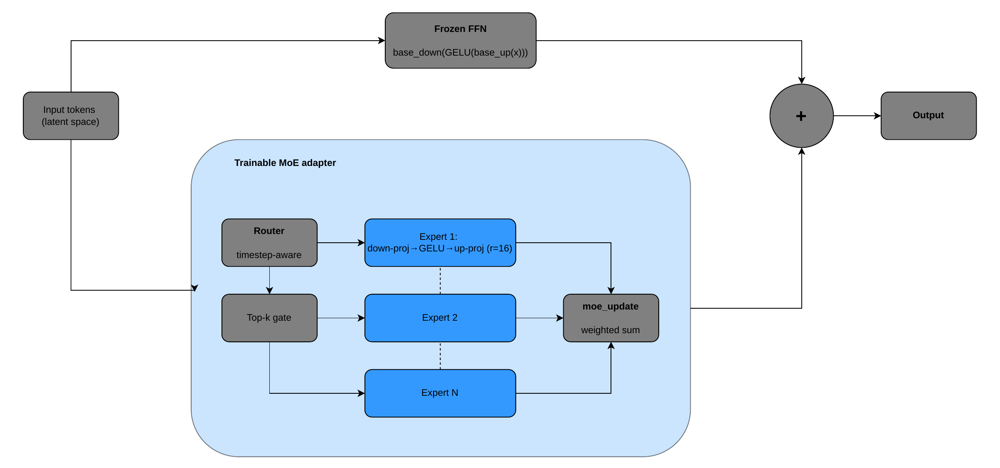
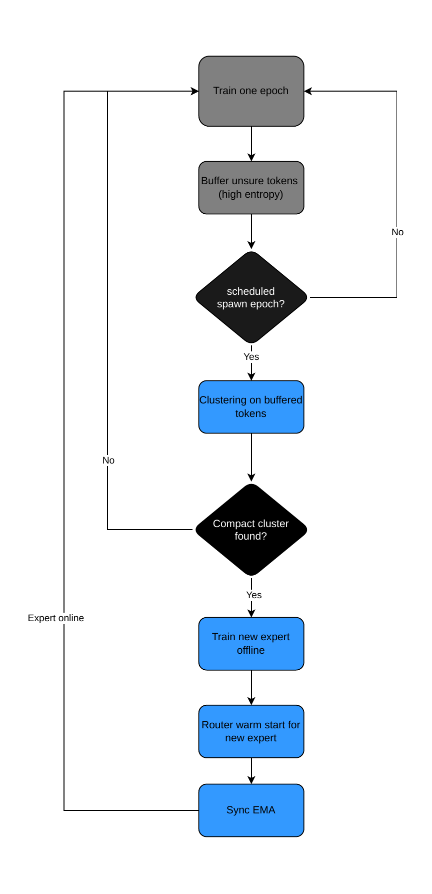

# Online update of expert assignment for long tail generation

A Dynamic Mixture of Experts Approach for Rare Pathology Synthesis.

Code for the master thesis by Edoardo Berardi Vittur (Friedrich-Alexander-
Universität Erlangen-Nürnberg). The task is text-conditioned chest X-ray generation on
MIMIC-CXR, with a focus on rare (long-tail) pathologies. A frozen diffusion
backbone is kept fixed and small Mixture-of-Experts LoRA adapters are added and
routed on top of it.

The theoretical background, the method derivation and the full results and
analysis are in the thesis. This repository holds the runnable code, organised
into two folders that correspond to the two lines of work described there.

## Repository structure

### `multi_lable_code/`: main method

The primary contribution. A frozen DiT backbone with LoRA experts injected at one
transformer block, routed in content space and grown online through dynamic
expert spawning. The folder covers the full pipeline: VAE latent caching, base
model training, MoE training with clustering and online spawning, synthetic
dataset generation and evaluation by FID and by downstream classification
(Macro-F1).
## Method overview

### Pipeline

Chest X-rays are encoded into latent space by a frozen VAE, and the pathology labels are turned into text prompts and encoded by a frozen T5 encoder. A frozen DiT backbone denoises the latents conditioned on the prompt. The only trained part is a small MoE-LoRA adapter (about 4.7M parameters) inserted into one transformer block. Generated latents are decoded back into synthetic X-rays, which are evaluated by FID and by training a downstream multi-label classifier (Macro-F1).

### MoE-LoRA adapter

The adapter sits next to the frozen feed-forward network of the chosen block and adds its output residually, so the base model stays unchanged. A timestep-aware router assigns each latent token (not each image) to its top-k experts. Each expert is a rank-16 LoRA adapter (down-projection, GELU, up-projection), and the expert outputs are combined as a weighted sum. Routing per token lets experts specialise on the small regions that contain a finding instead of on the healthy anatomy shared by all images.

### Dynamic expert spawning

The number of experts grows during training. After each epoch, tokens the router is unsure about (high routing entropy and high reconstruction error) are added to a buffer. At scheduled spawn epochs the buffered tokens are clustered. If a compact, distinct cluster is found, a new expert is trained offline on those tokens, given a warm start in the router and synchronised with the EMA weights before training continues. If no compact cluster is found, training continues with the current experts.

### `residual_error_moe/`: residual-routing study

The exploratory study behind the main method. It tests whether the base model's
residual-error direction can drive expert routing and whether any
inference-available signal (the hidden state, the label or a learned residual
prediction) can recover the routing that the true residual would produce. Each
signal is compared against a shared-adapter floor and two controls. This is the
investigation summarised in the Residual-Routing Study results (Table 2) of the
thesis.

Each folder has its own reproduction.md with the commands to run its experiments.

## Data and models

Both folders use MIMIC-CXR (the image shards and the multi-label CSV) and local
weights for the VAE, the T5 text encoder and a domain DenseNet-121 used by the
FID metric. The concrete paths are set inside each folder's scripts and its
`reproduction.md`.
